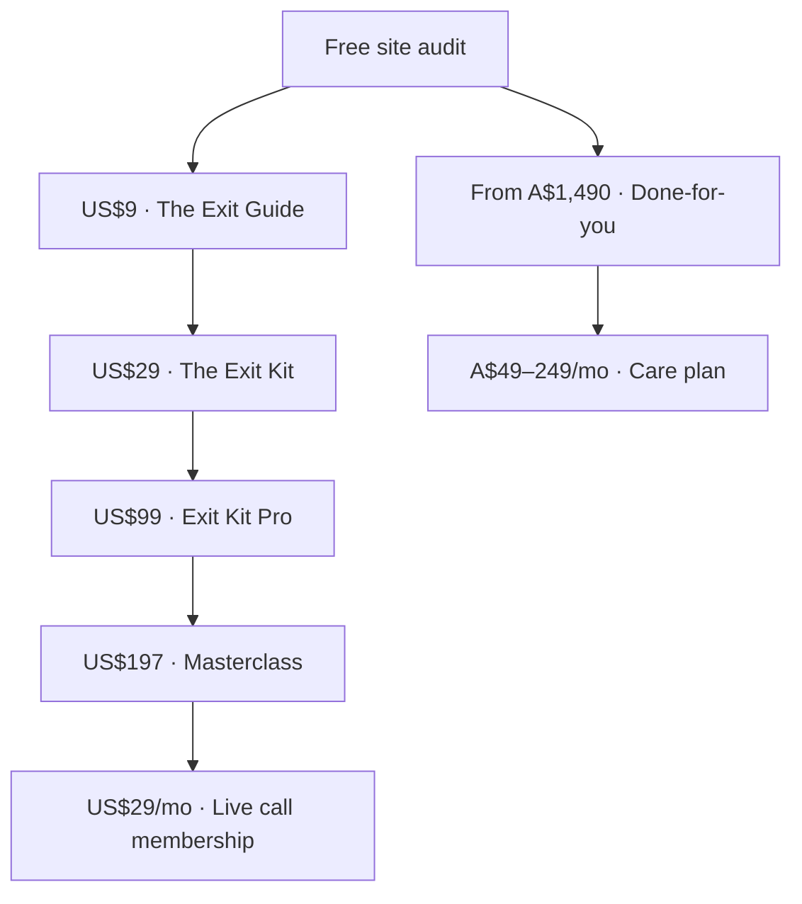

# Get Off WordPress: product and distribution plan

Snapshot of the live plan doc, 24 Nov 2026. The live doc is the source of truth while we plan; this file is the copy Claude Code works from. When the doc changes, re-export it here.

## Decisions at a glance

Sell one method in two ways under Hinterland Web:

- A DIY ladder at US$9 / $29 / $99 / $197.
- A separate done-for-you migration from A$1,490, followed by a monthly care plan.

Everything sells from hinterlandweb.com, built in Astro on Cloudflare, so the store itself shows the method works.

| Decision | Call | Why |
| --- | --- | --- |
| Brand | Hinterland Web | Existing brand, design system and LinkedIn content already running |
| Buyers | DIYers buy the ladder; SMB owners buy done-for-you | Two funnels, one method |
| DIY ladder | US$9 guide → $29 kit → $99 Pro kit → $197 masterclass | Global buyers; USD is the default for digital products |
| Done-for-you | From A$1,490, sold separately, not on the ladder | Market rate is A$1,500–8,000; $99 cannot cover a rebuild |
| Recurring | Care plan from A$49/mo; masterclass Q&A at US$29/mo after month one | The real long-term revenue |
| Masterclass | Recorded course + monthly live Q&A | Record once; the live call carries the price |
| Checkout | Polar (merchant of record) for digital; Stripe invoices for done-for-you | Polar handles GST/VAT and grants repo access automatically |
| Storefront | Self-hosted on hinterlandweb.com, not Stan Store | A rented store contradicts the "own your site" pitch |

## Positioning and buyers

The pitch: own your website, stop paying for plugins, stop getting hacked. It's taught by a small-business owner who runs his own pool business on this stack. Generic Udemy Claude Code courses and Fiverr "clone your site" gigs can't copy that.

| | DIY buyer | SMB owner |
| --- | --- | --- |
| Who | Freelancers, tinkerers, technical owners, VAs who want to resell the service | Tradies, pool and trade businesses, local services on WordPress, Wix or Squarespace |
| Trigger | Sick of WordPress upkeep and fees; curious about Claude Code | Site got hacked, renewal bill arrived, site is slow, web guy disappeared |
| Buys | $9 → $29 → $99 → $197 | Free audit → done-for-you → care plan |
| Needs to hear | The exact method, the repo, the prompts | "I'll move it, you'll own it, it won't break" |
| Price ceiling | Low hundreds (USD) | A$1,500–3,000 plus a monthly plan |

The market is moving our way: one crawler tracked 20,283 domains moving from WordPress to Astro in the 90 days to 5 Nov 2026, and 1,407 going the other way ([TechnologyChecker](https://technologychecker.io/migration/wordpress-to-astro)).

Our edge in the SMB market is the Swimart network and SPASA Queensland: pool businesses are a niche we can reach directly.

## Offer ladder

Each tier solves the next problem the buyer hits. Whatever a buyer paid counts toward the next tier.

| Tier | Price | What they get | Delivered by | Job it does |
| --- | --- | --- | --- | --- |
| Free audit | $0 | Enter a URL; get platform, speed score, plugin/CMS exposure and the yearly cost of staying put | Small tool on hinterlandweb.com | Captures emails; filters out SMBs who want done-for-you |
| The Exit Guide | US$9 | Web guide: should you move, what Astro + GitHub + Cloudflare are, the cost comparison, what replaces each plugin (forms, booking, blog, shop), the migration checklist (DNS, email MX records, redirects) | Gated page on our site | Cheap first purchase that builds trust |
| The Exit Kit | US$29 | Guide + private Astro starter repo + the Claude Code clone prompts/skill + a deploy-to-Cloudflare video + forms with Turnstile | Polar auto-invites buyers to the private GitHub repo | The actual tool |
| Exit Kit Pro | US$99 | Kit + full recorded real migration start to finish + an editing setup for non-coders (Keystatic or Sveltia CMS) + SEO module (301 redirect map, Search Console, GA4) + "Selling on a static site" module + one recorded review of their live site | Repo + videos + Loom review | Removes the "I'll get stuck" fear |
| Masterclass: Website → AI Operating System | US$197 | Pro + the Context OS modules (CLAUDE.md, skills, MCP connectors, Telegram-triggered workflows, real Swimart/PoolTrackr case studies) + first month of live Q&A | Course + monthly live call | The big promise: the website was step one |
| Q&A membership | US$29/mo | Monthly live call + recordings + community, from month two | Discord via Polar, or a private Skool group | Recurring revenue |

On price: Gradually.ai sells a comparable WordPress-migration Claude Code skill for €247 one-off ([Gradually](https://www.gradually.ai/en/wordpress-migration-skill/)). Our $29 and $99 tiers are cheap next to that. Keep them while collecting reviews, then test the Kit at $49 and Pro at $149.

Offer the Kit as a one-click +US$20 upgrade at checkout when someone buys the guide. Every guide page ends with a link to the next tier.

## How buyers move up

DIY buyers who are freelancers also refer jobs that are too big for them back to done-for-you.

## Done-for-you and care plan

Fixed packages in AUD including GST, with a 50% deposit. The care plan, not the build, is the long-term income. For reference, agency Astro migrations start around US$1,500 ([Hapy](https://hapy.co/journal/astro-migration-cost/)) and €5,000 ([Gradually](https://www.gradually.ai/en/wordpress-migration-skill/)).

| Package | Price (AUD inc GST) | Scope | Turnaround |
| --- | --- | --- | --- |
| Hacked-site rescue | A$1,490 | Up to 5 pages rebuilt from the live or cached site, malware gone because WordPress is gone, DNS cutover | 5 business days |
| Standard migration | A$2,490 | Up to 15 pages, blog import, 301 redirect map, forms, Search Console + GA4, editing setup | 2–3 weeks |
| Custom | Quote from A$3,990 | 15+ pages, bookings or other integrations; stores go to the "Store move" package | Scoped |

| Care plan | Price (AUD/mo) | Includes |
| --- | --- | --- |
| Keep-alive | A$49 | Uptime and form monitoring, dependency updates, backups (it's all in Git), domain/DNS watch |
| Edits by message | A$99 | Keep-alive + up to 5 small edits a month by Telegram voice note or email, quarterly speed report |
| Growth | A$249 | Edits + one new page or blog post a month + local SEO check |

The A$99 tier turns the Telegram voice-note bot into a product: "text us the change, it's live by tomorrow."

Ownership promise, in the contract: the client owns the domain, the Cloudflare account and the GitHub repo. Hinterland Web is added as a member. If they leave, they keep everything.

## E-commerce and WooCommerce

Take e-commerce jobs, but don't rebuild a cart in Astro. Choose the checkout by store size.

| Store size | Target stack | Running cost | Notes |
| --- | --- | --- | --- |
| 1–10 products, no stock control | Astro + Stripe Payment Links or Polar | Card fees only | Merch, vouchers, deposits, courses |
| Up to ~50 products, light stock | Astro + Shopify Starter Buy Button, or Snipcart | Shopify Starter US$5/mo with 5% card fees ([DemandSage](https://www.demandsage.com/?p=34726)); Snipcart 2% + gateway, about 4.9% + 30c on Stripe ([Snipcart](https://snipcart.com/blog/stripe-checkout-form-integration-vs-snipcart)) | Buy Button embeds products and checkout into any site |
| Real store: variants, shipping rules, stock, POS | WooCommerce → Shopify Basic (US$39/mo) ([Swell](https://www.swell.is/content/shopify-pricing)); Astro only for marketing/content pages if wanted | Plan + card fees + apps | Products, customers and orders move with tools such as LitExtension ([EasySell](https://easysellapp.com/hr/blogs/wiki/migrate-woocommerce-to-shopify-2026-guide)) |
| Big Woo store that must stay on Woo | Headless WooCommerce backend + Astro frontend ([eSEOspace](https://eseospace.com/blog/migrate-woocommerce-to-headless/)) | WordPress hosting stays | Don't sell it: WordPress (and its security risk) stays. Refer out |

Price a store migration as its own package, "Store move", from A$3,990 inc GST. Quote it on product count and on whether customers and orders move too. Store support is a separate monthly add-on.

## Where to sell

Build the store on hinterlandweb.com in Astro and take payment through Polar. Polar is the merchant of record, so it handles GST and VAT. It can also automatically invite buyers to a private GitHub repo or a Discord role ([Polar benefits](https://polar.sh/docs/features/benefits)).

| Option | Monthly | Per sale | Verdict |
| --- | --- | --- | --- |
| Self-hosted Astro + Polar | $0 Starter / US$20 Pro | 5% + 50c Starter; 3.8% + 40c Pro ([Copes](https://flaviocopes.com/payment-provider-fees/)) | Recommended |
| Self-hosted + Creem | $0 | 3.9% + 40c ([Copes](https://flaviocopes.com/payment-provider-fees/)) | Backup |
| Stripe invoices / Payment Links | $0 | Card fees | Done-for-you deposits and care plans |
| Stan Store | US$29 / US$99 Pro | 0% + processing | No: sales tools only on Pro, and it's a rented storefront ([Lilach Bullock](https://www.lilachbullock.com/stan-store-pricing/)) |
| Skool | US$9 / US$99 | 10% + 30c / 2.9% + 30c ([Uscreen](https://www.uscreen.tv/blog/skool-pricing/)) | Only as the Q&A community space |
| Unschooler / Marbles (AppSumo) | Paid | — | Don't build on them. Check whether you can export your content, then leave |

GST: Polar is the legal seller of the digital products, so it handles the tax on them. Done-for-you and care plans are our own Australian sales. They go through our GST registration (turnover threshold A$75,000). Confirm with the accountant which entity sends the invoices.

## Distribution channels

| Channel | Buyer | Play |
| --- | --- | --- |
| LinkedIn carousels | DIY + referrers | Organic, no pitch. The hacked-WordPress-to-Astro post reached 10k impressions; let the debate carry reach |
| Swimart network + SPASA Queensland | SMB | Free audit for members; one pool-business case study; same story in local Facebook groups |
| Free audit tool | Both | Every post ends with "check your site" |
| Hacked-site searches | SMB | Pages: "WordPress site hacked?", "Leaving Wix", "Leaving Squarespace" |
| GitHub | DIY | Public cut-down starter repo whose README points to the Kit |
| YouTube / short video | DIY | "Claude rebuilds this WordPress site in 20 minutes" demos |
| Referral | Both | 30% on DIY tiers via per-referrer discount codes |

## Ads and funnel pages

See [ads-playbook.md](ads-playbook.md) and [funnel-pages.md](funnel-pages.md) for the working detail.

Split paid ads by buyer:

- **Meta DIY ad set:** sells the US$9 guide as a self-liquidating offer.
- **Meta local ad set:** sends SMB owners within about 50 km of the Sunshine Coast to the free audit and done-for-you.
- **Google Search:** catches people looking for help with a hacked site.

LinkedIn stays organic, with no pitch. The hacked-WordPress → Astro → "talk to it through Claude" post reached 10k impressions with heavy debate in the comments. The commenters were mostly developers and agencies, so LinkedIn feeds the DIY ladder and referrals. Use that story as the first creative for both Meta ad sets.

Claude builds the pages in Claude Code and runs Meta ads through Meta's official MCP server. Every step becomes a post.

Competitive note: BrowserCat sells automated migrations from US$49 to $149, priced by page count ([BrowserCat](https://www.browsercat.com/migrate)). Our done-for-you has to sell what automation can't:

- rankings kept through redirects
- forms and email that keep working
- a local person
- the care plan

## What you might be missing

| Gap | Risk | Fix |
| --- | --- | --- |
| Editing after migration | Client feels locked out | Git-based CMS (Keystatic or Sveltia) on every build, or the A$99 plan |
| Plugin replacements | Forms, bookings, shop break | Standard parts list: Worker + Turnstile forms, Cal.com embed, Shopify Buy Button |
| SEO on cutover | Broken URLs drop rankings | 301 map from the old sitemap; Search Console at 7 and 30 days |
| Email on DNS move | Email stops | Copy MX, SPF, DKIM first: checklist item #1 |
| Cloning someone else's site | Copyright and brand risk | Only migrate sites the buyer owns; consent line at checkout and in the contract |
| Account ownership | "Web guy holds us hostage" | Client owns domain, Cloudflare and GitHub |
| Buyer's tool costs | DIY needs a paid Claude plan | Say so on the sales page; manual fallback in the guide |
| Platform drift | Videos go stale | Pin versions; re-record yearly; "lifetime v1 updates" only |
| Your time | Competes with Swimart | Max 2 done-for-you builds a month; Q&A one fixed hour a month |
| Refunds | Disputes | 14 days on guide and kit; none after a DFY build starts |
| Out of scope | Members sites, LMS, Woo stores that must stay on Woo | Say so up front; refer out |

## Build and launch plan

1. **Weeks 1–2: Foundation.** Record the next real migration as the reference build. Set up Polar products and the GitHub repo benefit, and build the product pages. Gate: one migration recorded, one test purchase that grants repo access automatically.
2. **Weeks 3–4: Launch $9 + $29 + done-for-you.** Guide, audit tool, two carousels, "WordPress hacked?" page. Start a 14-day Meta test at A$20/day through the Meta Ads MCP server. Gate: 10 buyers or 2 done-for-you enquiries.
3. **Weeks 5–8: $99 Pro + care plans.** Gate: 3 care-plan clients.
4. **Weeks 9–14: $197 masterclass** + first live Q&A + the $29/mo membership. Gate: 20 masterclass buyers before raising the price.
5. **Ongoing.** One case study a month; review prices quarterly.

## Open questions

- [ ] Which entity sends the invoices for done-for-you and care plans: Re5et Pty Ltd, or a separate Hinterland Web entity?
- [ ] Product name: "The Exit Kit", or something else?
- [ ] Q&A community: Discord (Polar grants it automatically) or a private Skool group?
- [ ] Which past migrations can be shown as case studies?
- [ ] Do the Unschooler and Marbles licences still work, and can you export your content from them?
- [ ] Show DIY prices in AUD as well as USD?
